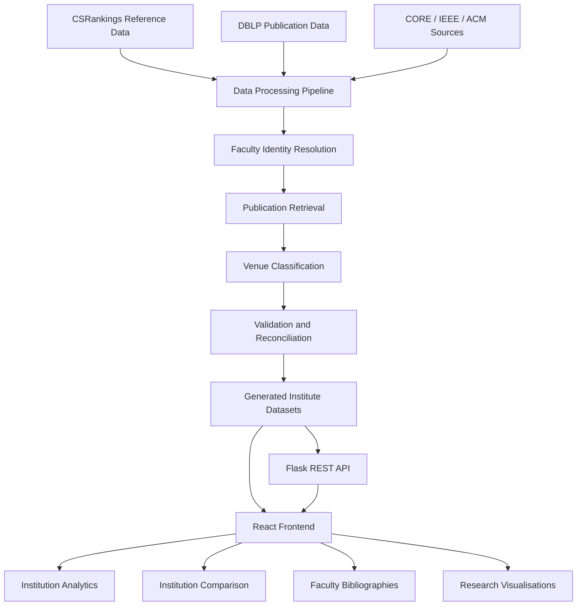

# India CS Research

### A Research Analytics Platform for Exploring and Comparing Computer Science Research Across Indian Institutions

India CS Research is a research analytics platform designed to explore, analyse, and compare Computer Science research output across Indian academic institutions.

The platform brings together faculty publication records, research-area analytics, institutional comparisons, and publication-level bibliographies through a unified interface. It uses DBLP publication data alongside CSRankings, CORE, IEEE, and ACM classification sources to provide a structured view of research activity.

The system supports institution-level comparisons as well as individual faculty exploration, with configurable year ranges, research areas, and publication sources.

---

## Table of Contents

- [Overview](#overview)
- [Key Features](#key-features)
- [System Architecture](#system-architecture)
- [Technology Stack](#technology-stack)
- [Data Sources](#data-sources)
- [Research Methodology](#research-methodology)
- [Publication Counting and Ranking](#publication-counting-and-ranking)
- [CORE, IEEE and ACM Integration](#core-ieee-and-acm-integration)
- [Project Structure](#project-structure)
- [Getting Started](#getting-started)
- [Building the Research Datasets](#building-the-research-datasets)
- [API Documentation](#api-documentation)
- [Generated Data Artifacts](#generated-data-artifacts)
- [Validation and Verification](#validation-and-verification)
- [Limitations and Considerations](#limitations-and-considerations)
- [Future Scope](#future-scope)
- [References](#references)

---

## Overview

Evaluating academic research performance requires more than simply counting publications. Research output must be examined across multiple dimensions, including publication venues, research domains, faculty contributions, institutional affiliations, and publication timelines.

India CS Research addresses this challenge by providing a unified platform that:

- Identifies Indian academic institutions using the CSRankings institutional roster.
- Resolves institutional faculty identities against DBLP records.
- Retrieves and processes faculty publication bibliographies.
- Classifies publications across research areas and publication sources.
- Computes faculty-level and institution-level research metrics.
- Enables interactive comparisons between institutions.
- Provides detailed publication bibliographies for individual researchers.

The platform is designed around reproducible data processing, transparent counting methodologies, and independent validation against reference datasets.

## Key Features

### 1. Institutional Research Analytics

- Explore Indian institutions included in the pinned CSRankings roster.
- View institution-level research statistics.
- Analyse publication output across configurable year ranges.
- Compare institutional research performance side by side.
- Examine faculty strength and research contributions.

### 2. Faculty-Level Research Exploration

- Browse faculty members associated with each institution.
- Search and navigate individual researcher profiles.
- Explore complete available publication bibliographies.
- Filter publications by year, venue, and publication source.
- Sort and search publication records.
- View publication distribution through interactive charts.

### 3. Multi-Source Publication Analysis

The platform supports multiple publication classification sources:

| Source | Description |
|---|---|
| CSRankings | Publications in recognised Computer Science research venues |
| CORE A* | Publications in CORE A* ranked conferences |
| CORE A | Publications in CORE A ranked conferences |
| IEEE | Eligible IEEE conference publications |
| ACM | Eligible ACM conference publications |

Users can select individual sources or combine them for broader research analysis. Overlapping publications are deduplicated in combined selections.

### 4. Interactive Research Visualisation

- Institutional comparison views.
- Faculty publication statistics.
- Research-domain summaries.
- Publication-venue distribution charts.
- Year-based filtering.
- Search, sorting, and dynamic source selection.

### 5. Data Integrity and Reproducibility

- Pinned reference datasets.
- DBLP identity verification.
- Publication-level deduplication.
- Independent faculty/venue/year reconciliation.
- Explicit handling of unresolved faculty identities.
- Validation reports for identifying missing and additional publications.

---

## System Architecture

The platform consists of a React-based frontend, a Flask API, and a Python-based research data-processing pipeline.



### Frontend

The frontend provides the interactive research exploration interface. It supports institutional navigation, comparison, faculty discovery, publication filtering, and data visualisation.

### Backend

The Flask API exposes endpoints for retrieving institutional datasets, research-domain summaries, validation reports, and individual faculty publication records.

### Data Processing Pipeline

The Python pipeline handles:

1. Reference dataset preparation.
2. Faculty identity resolution.
3. DBLP bibliography retrieval.
4. Publication metadata extraction.
5. Venue classification.
6. Publication deduplication.
7. Research metric computation.
8. Independent validation and dataset generation.

### Data Storage

Generated publication datasets are stored as structured JSON artifacts. The application can operate using bundled snapshots without requiring a running backend or PostgreSQL database.

The optional legacy PostgreSQL export remains available for database-based workflows.

---

## Technology Stack

| Component | Technologies |
|---|---|
| Frontend | React 19, JavaScript, Vite |
| Routing | React Router |
| Visualisation | Chart.js, React Chart.js 2 |
| Backend | Python, Flask, Flask-CORS |
| Data Processing | Python, Requests, XML and JSON processing |
| Publication Database | DBLP |
| Research Classification | CSRankings, CORE2023, IEEE, ACM |
| Optional Database | PostgreSQL |
| Development Tools | Git, GitHub, Node.js, npm |

---

## Data Sources

The platform integrates multiple academic research sources.

### DBLP

DBLP is the primary source for faculty publication bibliographies and publication metadata.

The pipeline uses DBLP's public SPARQL service to retrieve publication records and researcher information.

### CSRankings

CSRankings provides:

- Institutional reference data.
- Faculty listings.
- Research-area classifications.
- Reference publication counts.
- Venue mappings.

The project uses a pinned CSRankings revision to ensure reproducibility.

### CORE

The CORE2023 conference ranking catalogue provides A* and A-ranked conference classifications.

### IEEE and ACM

IEEE and ACM publication records are identified through publisher DOI prefixes and publication metadata, subject to the project's eligibility rules.

---

## Research Methodology

### 1. Institutional Identification

Indian institutions are identified using the country code `in` in the pinned CSRankings institutional dataset.

Faculty records are obtained from the corresponding CSRankings faculty roster.

### 2. Faculty Identity Resolution

Faculty names are matched against DBLP researcher identities.

The resolution process follows these rules:

1. Match the DBLP primary name.
2. If unavailable, identify a unique DBLP researcher using alternate names.
3. If multiple researchers share a name, use the DBLP homepage or institutional affiliation to resolve the identity.
4. Leave unresolved or ambiguous identities unassigned rather than making speculative matches.

The resolution process also handles duplicate researcher entries and DBLP name variations.

Resolved and unresolved faculty records are maintained separately for transparency.

### 3. Publication Retrieval

Once identities are resolved, the pipeline retrieves the corresponding DBLP bibliographies.

Publication metadata includes:

- Title
- Authors
- Publication year
- Venue
- DBLP identifier
- DOI, where available
- Pages
- Volume and issue information

Retrieved records are cached to avoid unnecessary repeated requests.

### 4. Venue Classification

Publications are mapped to research areas and publication sources using the project's pinned venue mappings and explicit classification rules.

### 5. Deduplication

DBLP publication identifiers are used to prevent duplicate counting when publications belong to multiple selected sources or research areas.

### 6. Validation

Generated institutional metrics are independently compared against reference publication counts.

Validation is performed at the faculty, venue, and publication-year level.

---

## Publication Counting and Ranking

The platform distinguishes between individual faculty publication counts, unique institutional publications, and adjusted research credit.

### Faculty Publication Count

A publication is counted for every faculty member who authored it.

Therefore, the same publication may contribute to multiple faculty publication counts.

### Unique Institute Publications

Each publication is counted only once at the institutional level using its DBLP identifier.

### Adjusted Research Credit

To account for co-authorship, each faculty author receives fractional credit:

\[
\text{Credit per author} = \frac{1}{N}
\]

Where \(N\) is the total number of authors on the publication.

The adjusted institutional credit is the sum of these fractional contributions for the selected faculty and publications.

### Time Window

The default inclusive publication window is **2016–2026**.

Users can change the start and end years to explore different publication periods.

### CSRankings Comparison

For CSRankings-only selections, the API also provides an average-count metric grouped by the selected research areas, including areas with zero publications.

The implementation does not apply arbitrary recency bonuses or count every DBLP record indiscriminately.

---

## CORE, IEEE and ACM Integration

### CORE Integration

The platform supports:

- CORE A* conferences.
- CORE A conferences.
- Combined CSRankings and CORE selections.

The CORE2023 catalogue is used for venue classification.

The implementation uses exact case-insensitive acronym matching, explicit DBLP venue aliases, and identified exceptions for ambiguous venue names.

Overlapping publications are counted only once.

Workshop variants and unrelated publication tracks are excluded according to the implemented eligibility rules.

### IEEE and ACM Integration

IEEE and ACM publications are identified using DBLP DOI publisher prefixes:

| Publisher | DOI Prefix |
|---|---|
| IEEE | `10.1109` |
| ACM | `10.1145` |

The implementation focuses on eligible main-conference publications.

Workshop proceedings, companion and adjunct volumes, extended abstracts, posters, demos, doctoral symposia, and co-located satellite events are excluded.

Publications already classified under CSRankings research areas retain those classifications. Other eligible publications are grouped under additional IEEE/ACM research areas.

Combined source selections deduplicate overlapping publications.

---

## Project Structure

The repository is organised into frontend, backend, scripts, tests, and generated research datasets.

```text
BTP/
│
├── backend/
│   ├── api/
│   │   └── app.py
│   │
│   ├── data/
│   │   ├── raw/
│   │   ├── cache/
│   │   └── processed/
│   │       ├── institutes.json
│   │       └── institutes/
│   │
│   ├── scripts/
│   │   ├── prepare_sources.py
│   │   ├── institutes.py
│   │   ├── build_institutes.py
│   │   ├── build_iiitd_dataset.py
│   │   ├── run_pipeline.py
│   │   ├── extract_domains.py
│   │   └── audit_core_counts.py
│   │
│   ├── tests/
│   └── requirements.txt
│
├── public/
│
├── src/
│
├── tests/
│
├── package.json
├── index.html
├── vite.config.js
└── README.md
```

*Note: This is a high-level representation of the project structure. Some generated data files and supporting modules are omitted.*

---

## Getting Started

### Prerequisites

Ensure that the following are installed:

- Node.js and npm
- Python 3.10 or later
- Git

### 1. Clone the Repository

```bash
git clone https://github.com/palak363/BTP.git
cd BTP
git checkout Latest
```

### 2. Install Frontend Dependencies

```bash
npm install
```

### 3. Start the Frontend

```bash
npm run dev
```

Open the application at:

`http://localhost:5173`

The frontend includes bundled institutional publication snapshots. Therefore, the primary research exploration features can operate without starting the Flask backend.

### 4. Start the Backend (Optional)

Open another terminal and install the backend dependencies:

```bash
python -m pip install -r backend/requirements.txt
```

Start the Flask API:

```bash
python backend/api/app.py
```

The backend runs on:

`http://127.0.0.1:5000`

Vite proxies `/api` requests to the local Flask server.

For a separately deployed frontend, configure the API origin using:

```env
VITE_API_BASE_URL=https://your-api-domain
```

The API reads the generated publication artifacts directly. PostgreSQL is not required for the current pilot application.

---

## Building the Research Datasets

The project provides scripts for preparing reference data, resolving institutional faculty, retrieving publications, and generating validated institutional datasets.

Run the following commands from the repository root.

### 1. Prepare Reference Sources

```bash
python backend/scripts/prepare_sources.py --download-only
```

This downloads checksum-verified reference inputs.

To additionally import the CORE2023 catalogue:

```bash
python backend/scripts/prepare_sources.py --download-only --core
```

### 2. Resolve Faculty Identities

```bash
python backend/scripts/institutes.py
```

This resolves faculty identities across the Indian institutional roster and generates:

- `india_faculty.csv`
- `india_unresolved.csv`

### 3. Build Institutional Datasets

```bash
python backend/scripts/build_institutes.py
```

The pipeline retrieves DBLP bibliographies, classifies publications, performs reconciliation, and generates institutional datasets.

### 4. Offline Rebuild

Once the bibliographies have been cached, datasets can be rebuilt without additional network retrieval:

```bash
python backend/scripts/build_institutes.py --offline
```

To rebuild selected institutions:

```bash
python backend/scripts/build_institutes.py --offline \
    --institute "IIT Bombay" \
    --institute "IISc Bangalore"
```

### 5. Refresh Bibliographies

To explicitly refresh all bibliographies:

```bash
python backend/scripts/build_institutes.py --refresh
```

### 6. Build IIIT Delhi Only

The following scripts support the IIIT Delhi-specific workflow:

```bash
python backend/scripts/build_iiitd_dataset.py
python backend/scripts/run_pipeline.py
python backend/scripts/extract_domains.py
```

A full initial build retrieves approximately 1,100 bibliographies and may take around 20–60 minutes. Subsequent builds reuse cached records.

---

## API Documentation

The Flask backend exposes REST endpoints for institutional data, research-domain summaries, validation reports, and individual faculty bibliographies.

### Available Endpoints

| Method | Endpoint | Description |
|---|---|---|
| GET | `/institutes` | Retrieve the institutional directory and summary data |
| GET | `/institutes/<slug>` | Retrieve a specific institution's dataset |
| GET | `/institutes/<slug>/domains` | Retrieve institutional research-domain summaries |
| GET | `/institutes/<slug>/validation` | Retrieve institutional validation information |
| GET | `/faculty/<name>` | Retrieve publications for an individual faculty member |

Institution slugs use lowercase names with non-alphanumeric characters replaced by hyphens.

Example:

```text
iit-bhu-varanasi
```

### Query Parameters

The institutional summary endpoints support:

| Parameter | Description |
|---|---|
| `start_year` | Starting publication year |
| `end_year` | Ending publication year |
| `sources` | Comma-separated publication sources |
| `area` | Research-area selection; may be repeated |
| `include_optional` | Include or exclude optional CSRankings venues |

Supported source identifiers:

```text
csrankings
core-a-star
core-a
ieee
acm
```

Example:

```text
GET /institutes/iit-bombay?start_year=2016&end_year=2026&sources=csrankings,core-a
```

### Faculty Bibliographies

The faculty endpoint returns available publication records for an exact faculty name, independently of institutional filters.

The faculty interface supports:

- Publication title search.
- Venue search.
- Year filtering.
- Venue filtering.
- Sorting.
- Publication distribution charts.
- Multiple publication-source selections.

Unknown faculty names return HTTP 404.

### Error Handling

| HTTP Status | Meaning |
|---|---|
| 400 | Invalid parameters or unsupported selections |
| 404 | Faculty or resource not found |
| 503 | Required dataset unavailable |

The previous IIIT Delhi-specific routes are also retained as compatibility aliases.

---

## Generated Data Artifacts

The processing pipeline generates structured JSON datasets.

### Institutional Summary

`backend/data/processed/institutes.json`

Contains:

- Institutional information.
- Faculty counts.
- Publication totals.
- Source-wise summaries.
- Faculty directory.

### Individual Institute Datasets

`backend/data/processed/institutes/<slug>.json`

Contains:

- Publication identifiers.
- Publication metadata.
- Faculty memberships.
- Source memberships.
- Unresolved faculty records.
- Dataset provenance.

### Validation Reports

`backend/data/processed/institutes/<slug>.validation.json`

Contains independent faculty, venue, and publication-year reconciliation results.

Validation failure reports are also generated when an institution does not satisfy the configured reference checks.

---

## Validation and Verification

Data reliability is an important part of the project.

The pipeline compares generated publication counts against the pinned CSRankings reference dataset.

Validation is performed across:

- Faculty members.
- Publication venues.
- Publication years.
- Optional research venues.
- Adjusted fractional credits.

### Reference Consistency

The CSRankings reference data, roster, venue mappings, and comparison rules are pinned to revision:

`b2e76bcec658a429c26011530767528839d524df`

Reference files are tracked using SHA-256 checksums.

### Handling Differences

The validation system distinguishes between:

- **Missing publications:** Publications present in the reference counts but absent from the generated dataset.
- **Additional publications:** Publications counted by the generated dataset but absent from the reference snapshot.

The normal pipeline prevents dataset replacement when unresolved missing-cell discrepancies exist.

The `--allow-reference-differences` option provides an explicit escape hatch for reviewed differences after source updates.

Raw publication counts are not overwritten to artificially force agreement.

### CORE Audit

Run:

```bash
python backend/scripts/audit_core_counts.py
```

The audit generates:

- `iiitd_core_audit.json`
- `iiitd_core_faculty_counts.csv`

These reports contain CORE catalogue coverage, unmapped venues, exclusions, and faculty-level publication counts.

The audit uses cached records and does not retrieve new bibliographies.

---

## Verification and Testing

Run the following commands to verify the application.

### Backend Tests

```bash
python -m unittest discover -s backend/tests -v
```

### Publication Processing Tests

```bash
node --test tests/publications.test.mjs
```

### Frontend Linting

```bash
npm run lint
```

### Production Build

```bash
npm run build
```

The project also includes browser-level checks covering responsive layouts, faculty navigation, filtering, publication search, sorting, and bibliography interactions.

---

## Limitations and Considerations

- Publication coverage depends on the completeness and accuracy of DBLP records.
- Ambiguous faculty identities are deliberately left unresolved rather than guessed.
- The institutional roster is based on a pinned CSRankings snapshot.
- CORE classification uses the CORE2023 catalogue and does not automatically reflect later catalogue editions.
- IEEE and ACM inclusion follows the project's DOI and venue eligibility rules.
- The platform's adjusted credit metric is not equivalent to the official CSRankings geometric-mean ranking.
- Bundled publication snapshots may not reflect the latest upstream DBLP additions until the data pipeline is refreshed.
- The optional PostgreSQL exporter is a legacy workflow and is not required by the current API.

---

## Future Scope

Potential directions for further development include:

- More comprehensive institutional coverage.
- Automated periodic publication-data refreshes.
- Additional academic publication databases.
- Advanced research collaboration and co-authorship analysis.
- Research trend analysis across institutions and time periods.
- Improved faculty identity resolution.
- More detailed institutional benchmarking.
- Expanded research-domain visualisations.
- Additional validation against independent bibliometric sources.

---

## References

1. **DBLP Computer Science Bibliography**  
   https://dblp.org/

2. **DBLP Public SPARQL Service**  
   https://sparql.dblp.org/sparql

3. **DBLP SPARQL Documentation**  
   https://blog.dblp.org/2024/09/09/introducing-our-public-sparql-query-service/

4. **CSRankings**  
   https://csrankings.org/

5. **CSRankings Reference Repository**  
   https://github.com/emeryberger/CSrankings/tree/b2e76bcec658a429c26011530767528839d524df

6. **CORE Conference Rankings – CORE2023**  
   https://portal.core.edu.au/conf-ranks/?source=CORE2023

---

## Project Information

**Project:** India CS Research  
**Repository:** https://github.com/palak363/BTP  
**Active Development Branch:** `Latest`

Developed as an academic research and engineering initiative focused on making Computer Science research output across Indian institutions more accessible, structured, and comparable.

